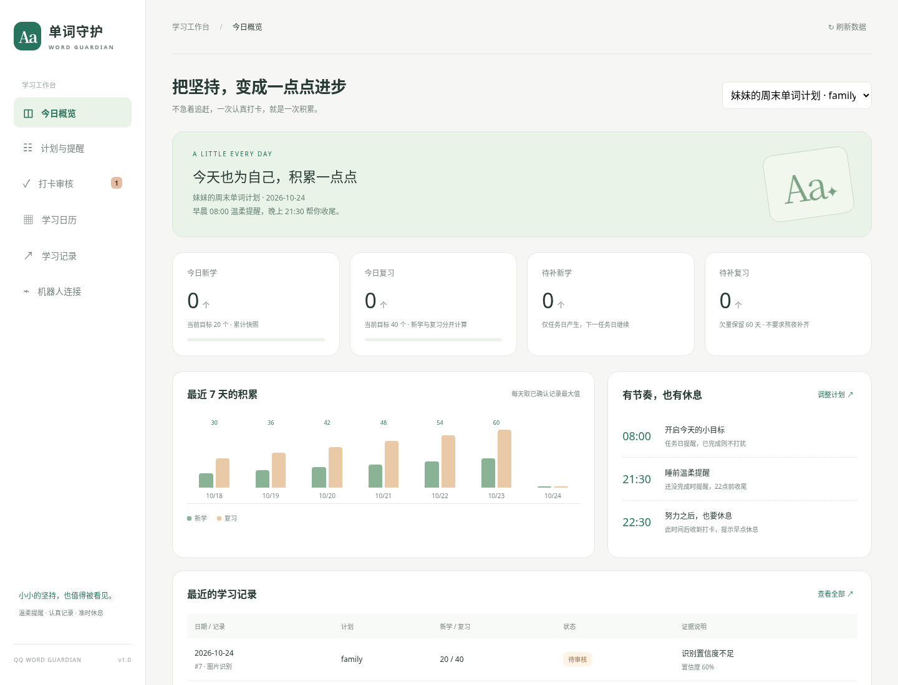

# QQ 单词守护 · Word Guardian

为 AstrBot 的 QQ 群聊准备的单词学习打卡插件：**截图识别、休息日提醒、漏学量顺延、温柔鼓励和管理面板**。

这个仓库已从 Steam 监控示例改为独立学习插件；保留 Git 历史，不再加载 Steam 监控功能。仓库地址继续使用当前 fork，插件内部名称为 `qq_word_guardian`。



[查看手机布局（演示数据）](docs/images/dashboard-mobile.png)

## 默认规则

1.0.2：按已完成数量及识别置信度审核，无日期或日期不符不再单独触发审核，按消息收到当天记录。旧计划无需重新绑定；仅因日期待审核且数量可信的图片自动计入，人工审核模式和低置信度记录保持待审核。

1.0.1 修复：兼容 AstrBot「群内独立会话」生成的 `发送者ID_群ID` 会话，管理员可直接在目标群绑定，无需关闭独立会话。

| 项目 | 默认行为 |
| --- | --- |
| 学习日 | 中国大陆周六、周日及法定放假日，排除调休上班日 |
| 学校例外 | 面板指定日期 `true` 要打卡，`false` 免打卡，优先于国家日历 |
| 周五晚 | 可自愿打卡，不自动增加任务；周日返校可单独设免打卡 |
| 基础目标 | 新学 20 个、复习 40 个，分开记账 |
| 早晨 / 晚间 | 08:00、21:30，任务未完成时各提醒一次；晚间须早于 22:00 |
| 太晚打卡 | 北京时间 22:30 起收到学习打卡后提示休息，不催当晚补量 |
| 漏学补量 | 顺延至下一任务日，默认滚动保留 60 天；可关闭和调整 |
| 时间与重启 | 每计划独立时区，默认 Asia/Shanghai；15 分钟补发窗口，错过不刷屏追发 |
| 识别 | 复用 AstrBot 已配置的视觉模型；可独立指定识别、鼓励模型 |
| 截图审核 | 数量清晰、置信度达标直接记录；数量不明确或手动开启全审核时待审核 |
| 隔离 | 精确匹配适配器实例、机器人身份、群ID和目标成员身份 |

例如：周六没完成，则周日目标为新学 **40**、复习 **80**；周六完成新学 10、复习 30，则周日目标为新学 **30**、复习 **50**。上课日不增加欠量，自愿打卡可抵扣已有欠量。超额完成不预支未来任务。每日展示目标有上限，超过部分的欠量保留在账本，不能要求熬夜补齐。

## QQ 官方机器人：先了解这两个限制

1. **群消息接收范围由 QQ 开放平台决定。** 普通官方群机器人通常只能收到 `@机器人` 的消息，因此建议妹妹发送 **@机器人＋学习截图**。插件无法承诺读取未被官方投递的普通群消息。需无 @ 自动接收时，先确认官方授权能力，或使用支持群消息接收的 OneBot / NapCat 适配器。
2. **定时主动群消息需要官方权限和额度。** 本插件使用绑定适配器的 `post_group_message`，不伪造被动回复 `msg_id`。权限不足、额度耗尽或离线时，面板显示发送异常，发送失败不会记作已发送。官方消息规则、主动推送权限及风控变化以 QQ 开放平台为准。

官方开发者平台的扫码登录用于管理开发者账号，不等于插件扫码登录 QQ。**官方机器人通过 AstrBot 的 QQ 官方适配器接入，AppID / AppSecret 只在 AstrBot 机器人设置中填写。** 本插件不索取密钥、不内嵌不受支持的登录二维码。OneBot / NapCat 的二维码应在其自己的受信管理端使用。

本插件只约束自己的收发，**无法禁止其他插件给同一个机器人发消息**。需要完全独立时，使用专用 QQ 机器人＋单独的 AstrBot 实例，或在 AstrBot 中为该机器人停用其他插件。

## 安装与绑定

需要 **Python 3.12、AstrBot ≥ 4.29.1**。模型需支持图片理解；普通纯文本 API 不能识别截图。

1. 在 AstrBot 插件管理中安装此仓库：`https://github.com/LiChenguang6/astrbot_plugin_steam_status_monitor`。若此前安装了 Steam 示例，请先停用/卸载该示例再安装；旧 Steam 数据不会迁移、删除或使用。插件内部身份已变更，更新后应重启 AstrBot 刷新插件与面板注册。
2. AstrBot 安装插件时使用 `requirements.txt` 安装依赖。已有模型配置可继续使用，不需要在插件再填 API 密钥。
3. 在 AstrBot「机器人」中配置专用 QQ 官方适配器，验证机器人能在目标群回复 @ 消息。把你的管理员身份加入 AstrBot 管理员配置（官方账号使用实际返回的成员 ID）。
4. 请让妹妹知道打卡的记录规则。在群中让她 `@机器人 /单词身份`，查看她在该适配器下的实际成员 ID。
5. 你作为 **AstrBot 管理员**，在目标群 `@机器人 /单词绑定 妹妹的实际成员ID`，也支持 `/单词绑定 @妹妹`。如果官方事件不包含被 @ 成员身份，用上一步的实际 ID。
6. 在 AstrBot WebUI 的插件详情打开「单词守护」面板，设置计划、视觉模型、日历例外和文案。在「机器人连接」中点击测试发送（每天每计划最多一次）。
7. 妹妹发送 `@机器人＋截图` 即可进入识别；文字打卡可用 `/单词打卡 新学20 复习40`。数量清晰直接记录；数量不明确时待审核，你可在面板确认或 `/单词确认 记录ID`。

**QQ 号、QQ UID、member_openid 不是自动互换的身份。** 插件把它们作为字符串精确匹配，可在面板填写别名，但必须是当前适配器实际能返回的同一个人的 ID。QQ 官方群 ID 通常是 `group_openid`，不是数字群号；会话从绑定事件捕获，不要猜测或手工拼凑。默认计划 ID 为 `family`；多计划可用 `/单词绑定 成员ID plan2`，每个成员在同一机器人与群只允许启用一个计划。

## 面板提供什么

- **今日概览**：今日新学/复习、目标进度、历史欠量、最近七天累计趋势、提醒时刻。
- **计划与提醒**：多计划、启停、基础数量、星期安排、开始日期、时区、调课/请假、早晚提醒、太晚界限、欠量有效期和每日展示上限。
- **识别与鼓励**：独立模型、置信度阈值、全人工审核、数量识别审核、文字打卡开关、AI 鼓励开关、风格、冷却与保留天数。
- **自定义文案**：早晚提醒支持 `{new}`、`{review}` 两个剩余量占位符；可自定义太晚打卡的休息提示。
- **打卡审核**：待审核、改数、确认、驳回；已确认记录也可改数或撤销。
- **学习日历**：当前月的学习日、日期例外、累计数量；年份数据缺失时明确报告，不猜测。
- **学习记录**：查看最近 500 条记录、手动补录、导出最多 10,000 条 CSV。
- **机器人连接**：非敏感适配器信息、绑定目标、主动消息测试、近期管理审计。

计划创建后默认关闭；完成群内绑定才会启用。已有记录时，目标数量、基础星期/节假日规则、开始日期、时区及身份不能直接重写，以免历史账本被重新解释；需要改变时新建计划、停用旧计划。单日的学校例外仍可调整，也会影响该日是否产生欠量。新计划不会自动继承旧计划欠量。

## 截图识别与记账边界

示例截图：书籍进度 `2016 / 4440`、`已新学 20 / 20`、`已复习 40 / 40` → 记录 **新学20、复习40**，不能记录2016，也不能把计划目标当作完成量。图中缺少日期不影响记录；数量识别清晰且置信度达标就自动计入收到当天。未达到目标只表示尚未完成，不意味着必须审核。

- 新学与复习使用**当天累计快照**：同一天多张图/多次文字打卡，各字段取已确认记录的最大值，不能相加刷量。默认只面向一个学习账本；多个词书或多个 APP 的独立增量需管理员核对后补录当天总量。
- 每张截图按内容 SHA256 去重，同图换文案、隔天重发、与新图混发都不重复计入。裁剪、重拍或修改后的图不保证可检测；AI 无法证明真实性；需要人工逐张核对时可关闭自动计入。
- 只根据完成数量的识别置信度及自动计入开关决定审核。模糊数量按待审核保存，不猜测完成量；清晰的0也会如实记录。缺少日期或日期不符不触发审核，统一按接收当天记录；确属历史学习请撤销后手工补录。
- 手动补录允许计划开始日至今天。改小累计值时，须撤销其他更大的错误记录，否则每日最大值仍以那条记录为准。
- 一次最多三张图；解码后每张最多8MB、2000万像素，支持PNG/JPEG/WebP。每计划默认15秒冷却；处理中再次发截图会提示稍后重试，不静默当作完成。
- 提取失败不编造完成量；AI 鼓励失败退回固定反馈。夜间打卡的固定反馈优先提醒休息，不追加AI催量。
- 默认不@指定成员，提醒发到绑定群内，避免无谓打扰。群内其他成员和其他群的消息不会送入识别模型。

学习日历来自 `chinese-calendar==1.11.0`，当前提供 **2004–2026年** 的已公布安排。进入未覆盖年份时相关提醒暂停，面板提示升级；仍可保存打卡。升级库或明确指定日期例外后恢复。寒暑假、学校补课和返校时刻不等于国家节假日，需要你设置例外。

## 数据与隐私

SQLite 位于 AstrBot 的 `data/plugin_data/qq_word_guardian/guardian.sqlite3`，跟随 `ASTRBOT_ROOT`。仅记录计划、身份、日期、新学/复习数量、状态、置信度、固定审核原因、去重摘要和提醒状态；**不在插件数据库中保存原图、消息正文、图片链接或 API 密钥**。

匹配到的目标成员文本/图片会按配置发送给 AstrBot 已接入的模型；若只想识别图片，可关闭文字打卡。AstrBot/适配器的媒体下载缓存及模型服务商日志由各自设置控制，插件不声称能清除这些外部副本。默认启动和每日清理180天前的已处理记录，至少保留欠量窗口所需历史；待审核记录不自动删除。数据库应作为私有文件备份，不能提交到 GitHub。

面板使用 AstrBot 已登录管理会话，六个 API 都检查框架传入的登录身份；群内绑定/审核使用框架原生 ADMIN 权限。没有额外开放管理端口。插件热重载会取消调度和进行中的识别任务。提醒状态重启保留；如果发送成功后、保存发送状态前进程恰好崩溃，重启可能重复一次提醒，无法对外部 API 和本地 SQLite 实现跨系统恰好一次。

## 本地开发

```bash
python3.12 -m venv .venv
source .venv/bin/activate
python -m pip install -r requirements-dev.txt
python -m pytest -q
node --check pages/word-guardian/app.js
```

测试使用真实 AstrBot SDK 加载插件入口，模拟 QQ 事件、模型返回和官方发送 API；覆盖账本、日历、审核、提醒、身份隔离、管理接口认证和卸载取消。测试不会联系真实QQ群或调用付费模型。实际截图的模型准确率、官方授权、群消息投递和主动推送，仍需在你已接入的 AstrBot 实例中联调。

## 致谢与许可

MIT，保留原始 LICENSE。本仓库最初是 [Maoer233/astrbot_plugin_steam_status_monitor](https://github.com/Maoer233/astrbot_plugin_steam_status_monitor) 的 fork，参考其 AstrBot 面板集成方式；学习插件实现已独立重写。
